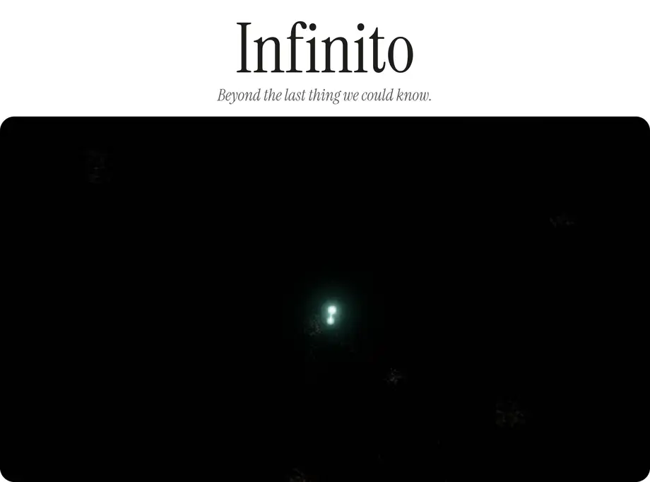
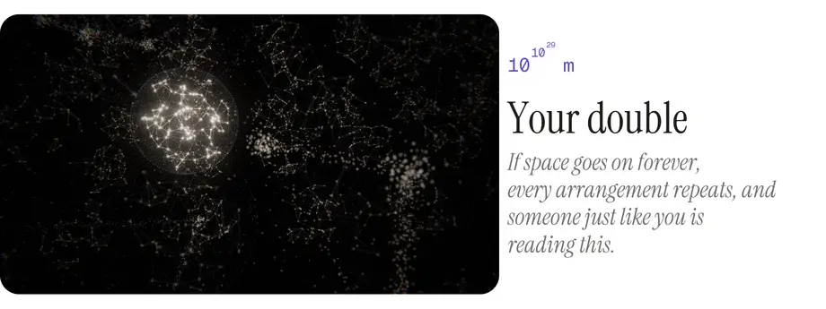
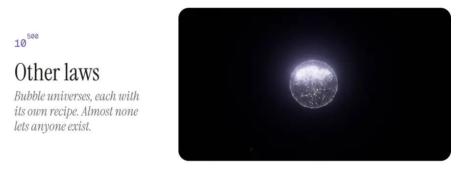
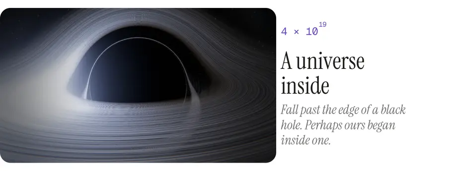
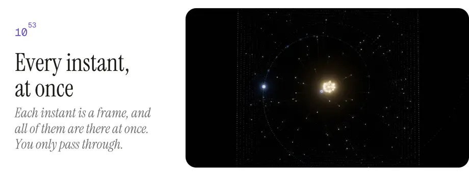
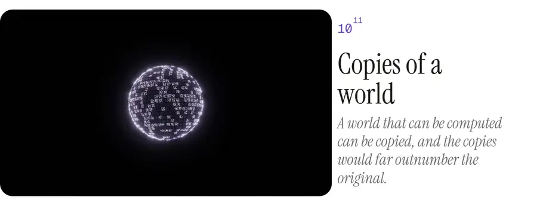
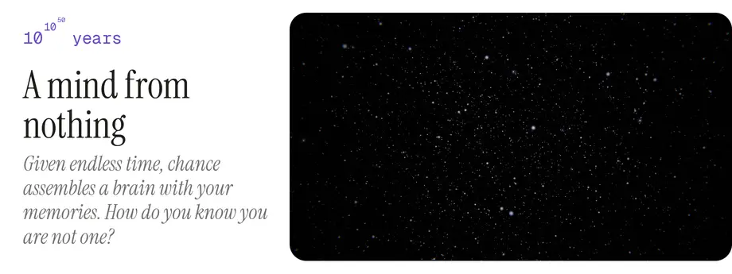
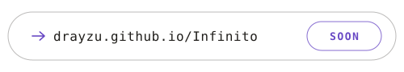

  <picture><source media="(prefers-color-scheme: dark)" type="image/avif" srcset="media/cover-dark.avif"><source media="(prefers-color-scheme: dark)" srcset="media/cover-dark.webp"><source type="image/avif" srcset="media/cover-light.avif"></picture>

  <picture><source media="(prefers-color-scheme: dark)" type="image/avif" srcset="media/double-dark.avif"><source media="(prefers-color-scheme: dark)" srcset="media/double-dark.webp"><source type="image/avif" srcset="media/double-light.avif"></picture>

  <picture><source media="(prefers-color-scheme: dark)" type="image/avif" srcset="media/laws-dark.avif"><source media="(prefers-color-scheme: dark)" srcset="media/laws-dark.webp"><source type="image/avif" srcset="media/laws-light.avif"></picture>

  <picture><source media="(prefers-color-scheme: dark)" type="image/avif" srcset="media/inside-dark.avif"><source media="(prefers-color-scheme: dark)" srcset="media/inside-dark.webp"><source type="image/avif" srcset="media/inside-light.avif"></picture>

  <picture><source media="(prefers-color-scheme: dark)" type="image/avif" srcset="media/time-dark.avif"><source media="(prefers-color-scheme: dark)" srcset="media/time-dark.webp"><source type="image/avif" srcset="media/time-light.avif"></picture>

  <picture><source media="(prefers-color-scheme: dark)" type="image/avif" srcset="media/copies-dark.avif"><source media="(prefers-color-scheme: dark)" srcset="media/copies-dark.webp"><source type="image/avif" srcset="media/copies-light.avif"></picture>

  <picture><source media="(prefers-color-scheme: dark)" type="image/avif" srcset="media/mind-dark.avif"><source media="(prefers-color-scheme: dark)" srcset="media/mind-dark.webp"><source type="image/avif" srcset="media/mind-light.avif"></picture>

  <a href="https://drayzu.github.io/Infinito/"><picture><source media="(prefers-color-scheme: dark)" srcset="media/enter-dark.svg"></picture></a>

 

How it's made

 

- The fourth piece of Horizontes (Espacio · Tiempo · Destino · Infinito): one scroll, about eight minutes, that asks what lies beyond and counts how many — as powers of ten, then as towers of powers (10^10^29), then the infinities — while it questions, one by one, everything you take for granted: that you are the only one, that your life is one, that time passes, that any of this is real.
- One voice, in the second person, and one protagonist: a point of teal light, you. Each act ends on the image the next one begins from, so the journey never cuts.
- Everything is points: the Earth comes from a shared library of bodies drawn in points over real maps (Solar System Scope, CC BY 4.0); the black hole is ray traced; the trees of branches, the bubble universes, the worlds of bits and the Mandelbrot set are points too.
- Most of what it shows is hypothesis, not observation — the double (Tegmark), the many worlds (Everett), eternal inflation and the string landscape, universes born in black holes (Smolin, Popławski), the block universe, the simulation argument (Bostrom), Boltzmann brains — and the piece says so.
- TypeScript, Three.js and Vite, no framework. `npm install`, `npm run dev`. The studies behind each act are in `estudios/`. The clips above are recorded from the piece itself: `node tools/clip.mjs`, then `python tools/readme_media.py`.

